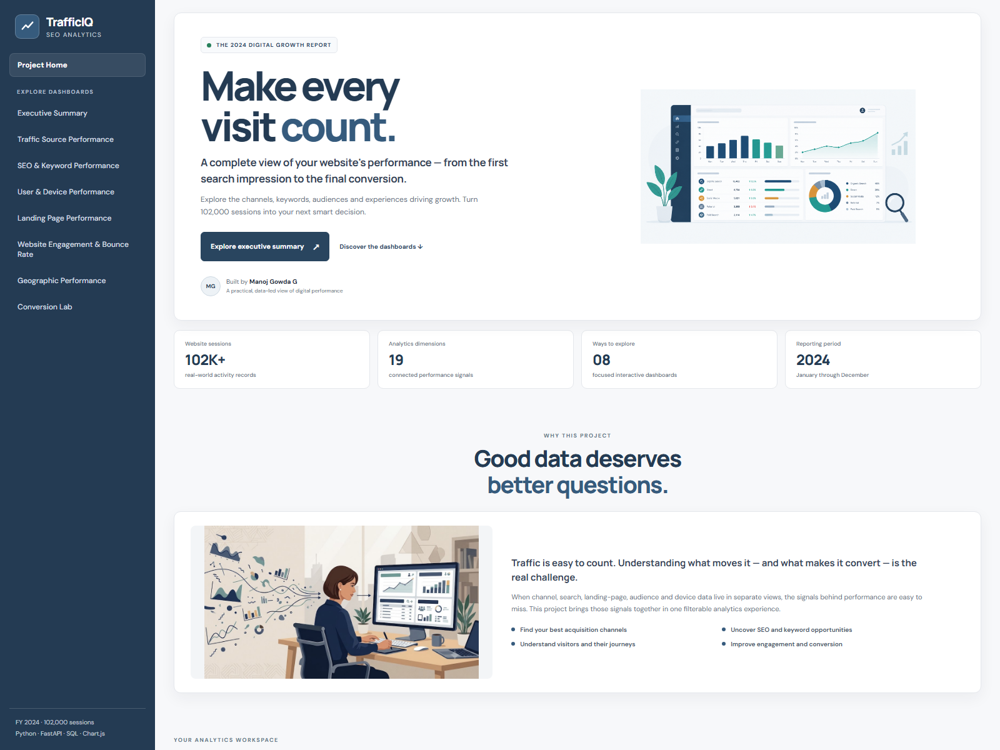
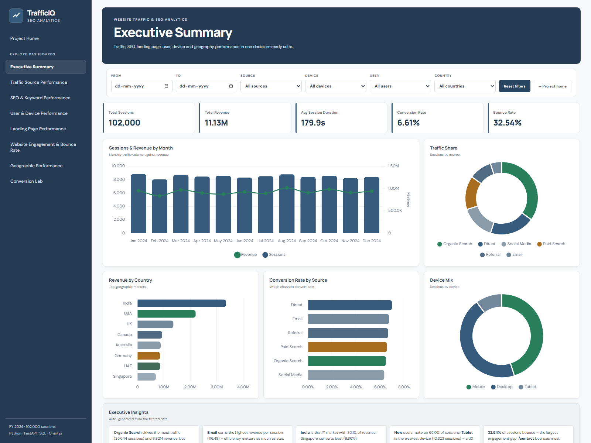
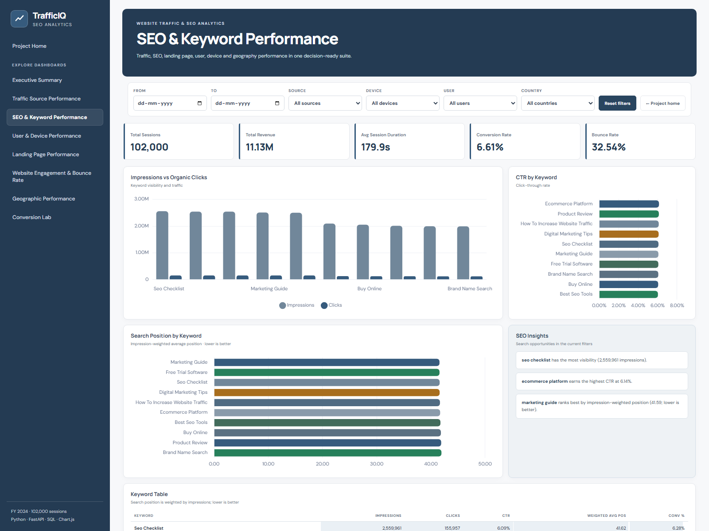
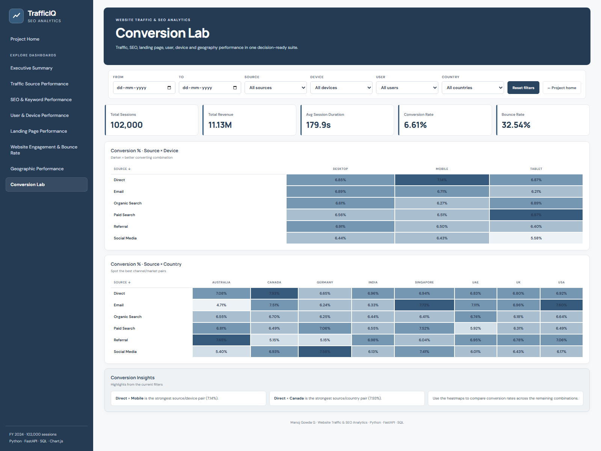

<div align="center">
  

  <p><strong>See where website traffic comes from, how visitors engage, and which channels and pages convert.</strong></p>

  <p>
    
    
    
    
  </p>
</div>

# TrafficIQ

TrafficIQ is a website traffic and search analytics application built with **Python, FastAPI, SQL, and Chart.js**. It turns a compressed CSV of **102,000 website sessions and 19 fields** into an interactive homepage and a collection of dashboards.

Use the dashboards to explore acquisition channels, search impressions and clicks, devices, audiences, landing pages, engagement, countries, and conversions. Date, source, device, user-type, and country filters update the dashboard data together.

> **Dataset note:** Reports show the bundled 2024 dataset (January 1–December 30), not a live connection to a website analytics provider. Revenue is displayed in the dataset's numeric units; no currency is inferred.

## Contents

- [Product tour](#product-tour)
- [Dashboards and metrics](#dashboards-and-metrics)
- [How the application works](#how-the-application-works)
- [Run locally](#run-locally)
- [Configuration](#configuration)
- [Deploy](#deploy)
- [API reference](#api-reference)
- [Data and calculations](#data-and-calculations)
- [Project structure](#project-structure)
- [Troubleshooting](#troubleshooting)
- [License](#license)

## Product tour

### Homepage

The project homepage introduces the dataset, explains what the analytics suite covers, and links to each report.



### Executive summary

Start with the overall session, revenue, duration, conversion, and bounce-rate KPIs, then review the channel, country, and device charts and the data-based executive insights.



### SEO and keyword performance

Compare keyword impressions, organic clicks, click-through rate (CTR), and impression-weighted search position. The keyword insights and table make the best-performing and highest-visibility terms easier to scan.



### Conversion analysis

Heatmaps compare conversion rates across traffic sources and devices or countries. Darker cells represent higher conversion rates.



## Dashboards and metrics

| Dashboard | Questions it helps answer |
|---|---|
| **Executive Summary** | How many sessions and conversions are there? How do revenue, traffic mix, and bounce rate look? |
| **Traffic Source Performance** | Which channels bring sessions, revenue, and conversions? Which has the highest revenue per session? |
| **SEO & Keyword Performance** | Which terms earn impressions and clicks? What are their CTR and weighted search positions? |
| **User & Device Performance** | How do new and returning visitors compare? Which devices bring traffic or convert? |
| **Landing Page Performance** | Which entry pages attract sessions and which convert? |
| **Website Engagement & Bounce Rate** | Where are bounce rates highest? How do session duration and page depth vary? |
| **Geographic Performance** | Which countries contribute traffic and revenue or have higher conversion? |
| **Conversion Lab** | How do conversion rates vary across source/device and source/country combinations? |

Dashboard insight panels summarize notable results from the currently loaded data. Charts, tables, heatmaps, and insights update when filters change.

## How the application works

```text
data/website_traffic.csv.gz
          │
          ▼
 Python / pandas load and database initialization
          │
          ▼
   SQLite (local) or PostgreSQL (configured)
          │
          ▼
 FastAPI filter and aggregate endpoints
          │
          ▼
 HTML + CSS + JavaScript + Chart.js dashboards
```

On startup, the backend creates and populates the `sessions` table from the bundled CSV if the configured database is empty. It also creates indexes for common filter and grouping fields. SQLite is the local default; PostgreSQL can be selected with `DATABASE_URL`.

## Run locally

### Requirements

- Python 3.10 or later
- Internet access in the browser to load Chart.js and the web fonts used by the interface
- No separate frontend build step

### Windows PowerShell

From the project directory:

```powershell
python -m venv .venv
.\.venv\Scripts\Activate.ps1
python -m pip install --upgrade pip
pip install -r requirements.txt
python -m uvicorn app.main:app --reload
```

If PowerShell prevents virtual-environment activation, you can invoke the environment's Python directly:

```powershell
.\.venv\Scripts\python.exe -m pip install -r requirements.txt
.\.venv\Scripts\python.exe -m uvicorn app.main:app --reload
```

### macOS or Linux

```bash
python3 -m venv .venv
source .venv/bin/activate
python -m pip install --upgrade pip
pip install -r requirements.txt
python -m uvicorn app.main:app --reload
```

Open [http://localhost:8000](http://localhost:8000) after Uvicorn reports that the server is ready. The first run reads the included compressed CSV and may take a little longer while the local database is initialized.

By default, the SQLite database is stored at `data/analytics.db`. That generated file is ignored by Git; the source dataset `data/website_traffic.csv.gz` is the input used to seed a fresh database.

## Configuration

No environment variable is required for local SQLite use. To connect to PostgreSQL, set `DATABASE_URL` **before starting the application**:

#### Windows PowerShell

```powershell
$env:DATABASE_URL = "paste-your-postgresql-connection-string-here"
python -m uvicorn app.main:app --reload
```

#### macOS or Linux

```bash
export DATABASE_URL="paste-your-postgresql-connection-string-here"
python -m uvicorn app.main:app --reload
```

Use the connection string provided by your PostgreSQL service, including any required SSL options. Never commit actual credentials, passwords, or a populated `.env` file. Hosting providers should receive database credentials through their secret/environment-variable settings.

## Deploy

The repository includes a `Dockerfile` and a Render Blueprint in `render.yaml`. For production, configure a managed PostgreSQL database so data persists across container restarts and deployments.

### Docker

Build and run the container:

```bash
docker build -t traffic-iq .
docker run --rm -p 8000:8000 -e DATABASE_URL="YOUR_DATABASE_URL" traffic-iq
```

Set `DATABASE_URL` to your PostgreSQL connection string. Do not put real credentials into source files or commit them. The container listens on port `8000` by default and uses the platform-provided `PORT` when available.

### Render Blueprint

1. Push this project to a GitHub repository.
2. In Render, choose **New → Blueprint** and select the repository.
3. Configure the requested `DATABASE_URL` environment variable with a PostgreSQL connection string.
4. Deploy the service and verify its health at `/api/health`.

SQLite is convenient for local development and small tests, but a database file on an ephemeral hosting filesystem may be lost when an instance is replaced. Use persistent managed PostgreSQL for a deployed service.

## API reference

| Method | Endpoint | Purpose |
|---|---|---|
| `GET` | `/api/health` | Return service health status. |
| `GET` | `/api/meta` | Return available filter values and the dataset's minimum and maximum dates. |
| `GET` | `/api/dashboard` | Return KPIs and grouped dashboard aggregates. |
| `GET` | `/docs` | Open FastAPI's interactive API documentation. |

`/api/dashboard` accepts optional query parameters:

| Parameter | Example | Description |
|---|---|---|
| `date_from` | `2024-01-01` | Include sessions on or after this date. |
| `date_to` | `2024-06-30` | Include sessions on or before this date. |
| `source` | `Organic Search` | Filter to one traffic source. |
| `device` | `Mobile` | Filter to one device type. |
| `user_type` | `Returning` | Filter to one user type. |
| `country` | `India` | Filter to one country. |

Example:

```text
http://localhost:8000/api/dashboard?date_from=2024-01-01&date_to=2024-06-30&device=Mobile
```

## Data and calculations

The compressed CSV contains **19 fields**:

| Category | Fields |
|---|---|
| Session and time | `date`, `month`, `session_id` |
| Visitor and acquisition | `user_type`, `traffic_source`, `device`, `country` |
| Pages and engagement | `landing_page`, `pages`, `duration`, `is_bounce`, `exit_page` |
| Search | `keyword`, `impressions`, `clicks`, `position`, `search_volume` |
| Conversion and value | `is_conv`, `revenue` |

Key metric definitions:

- **Sessions:** Number of session records in the filtered group.
- **Conversion rate:** Converted sessions divided by sessions, expressed as a percentage.
- **Bounce rate:** Bounced sessions divided by sessions, expressed as a percentage.
- **CTR:** Total clicks divided by total impressions, expressed as a percentage.
- **Weighted search position:** Sum of `position × impressions` divided by total impressions. If a group has no impressions, the average position is used.
- **Revenue per session:** Total revenue divided by sessions.
- **Heatmap values:** Conversion rate for each source/device or source/country group.

The included source file is `data/website_traffic.csv.gz`. To rebuild it from the original Excel workbook, run the preparation script from the project root:

```powershell
python scripts/prepare_data.py path\to\Website_Traffic_SEO_Analytics.xlsx
```

The workbook must contain the expected `Cleaned_data` sheet and columns referenced in `scripts/prepare_data.py`. The preparation script keeps every source row to preserve report totals and prints the count of rows flagged by the workbook's quality checks.

## Project structure

```text
app/
  db.py                  Database connection and CSV-to-database initialization
  main.py                FastAPI routes and dashboard aggregation
data/
  website_traffic.csv.gz Bundled source data used to seed a fresh database
scripts/
  prepare_data.py        Build the compressed CSV from the source workbook
static/
  index.html             Homepage and dashboard application shell
  app.js                 Filtering, chart configuration, tables, and insights
  style.css              Design system and responsive layout
  img/                   Homepage and dashboard illustrations
screenshots/             README banner and product screenshots
Dockerfile               Container build and application startup
render.yaml              Render Blueprint
requirements.txt         Python dependencies
```

## Troubleshooting

**The page opens, but dashboard data does not load**

- Confirm startup completed without errors in the terminal.
- Open [http://localhost:8000/api/health](http://localhost:8000/api/health) and [http://localhost:8000/api/meta](http://localhost:8000/api/meta).
- Verify `data/website_traffic.csv.gz` exists and that the configured database is reachable.

**The first startup is taking time**

An empty database must be seeded from the compressed 102,000-row dataset. Wait for FastAPI's startup to finish before using the dashboards.

**PostgreSQL connection errors**

- Check the `DATABASE_URL` value and ensure it is available in the server process environment.
- Confirm the database host permits connections from the deployment service.
- Include provider-required SSL parameters and keep secrets out of the repository.

**Port 8000 is already in use**

Run Uvicorn on another port, for example:

```powershell
python -m uvicorn app.main:app --reload --port 8001
```

Then open `http://localhost:8001`.

## License

This repository does not currently include a license. Add a `LICENSE` file before granting reuse or redistribution rights.
